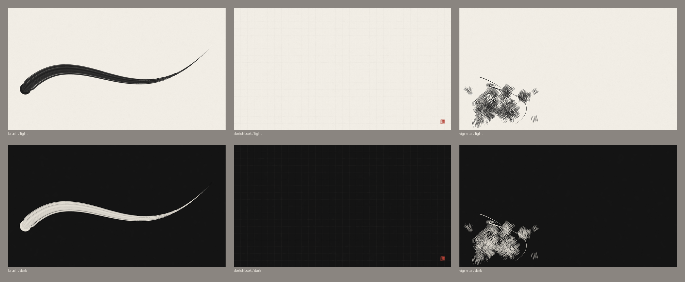

# ink-paper

An "ink on paper" desktop theme for GNOME, inspired by the feel of Kim Jung Gi's ink drawings:
warm paper, confident black linework, lots of empty space, and one small red accent like a
signature seal. Light ("paper") and dark ("ink") versions.



| Role       | Paper     | Ink       |
|------------|-----------|-----------|
| Background | `#F2EEE6` | `#141414` |
| Surface    | `#E7E2D8` | `#1E1E1E` |
| Text       | `#1A1A1A` | `#E9E4DA` |
| Muted      | `#8A8580` | `#5C5853` |
| Accent     | `#B23A2E` | `#C8473A` |

Red is used sparingly: focus, the active window, errors.

## Wallpapers

All generated with code (Pillow only), nothing traced or downloaded:

- **brush**: one sweeping stroke, thick to thin, with a dry-brush tail
- **sketchbook**: paper grain, a faint pencil grid, a tiny red seal
- **vignette**: empty paper with a dense cluster of hatching and contour strokes in one corner

```sh
python3 make_wallpapers.py                     # 1920x1080
python3 make_wallpapers.py --size 2560x1440    # other screens
```

## Desktop (GNOME)

```sh
sudo apt install fonts-ibm-plex papirus-icon-theme   # optional, used when present
bash apply.sh sketchbook        # or brush / vignette
ink-mode toggle                 # switch light/dark (installed to ~/.local/bin)
bash revert.sh                  # undo everything
```

`apply.sh` sets the wallpaper (light and dark), red accent, IBM Plex fonts, Papirus icons with
gray folders, an app stylesheet for GTK 4 / libadwaita (exact colors, squarer corners) and
color schemes for gnome-terminal, Ptyxis and Ghostty. Every file it changes is backed up as
`*.bak-<date>` first; your previous settings are kept in `backup/`.

## Apps

`bash apps-apply.sh` extends the theme to VS Code (own light/dark theme, follows the system),
Neovim with NvChad (base46 themes), Vim, tmux, the bash prompt, Firefox and Thunderbird
(`userChrome.css`), Joplin, the lock screen and Qt apps. `revert.sh` undoes this too.

`apps/writefreely-ink.css` is a matching theme for a [WriteFreely](https://writefreely.org) blog
(paste it under Customize → Custom CSS, or use `apps/writefreely-ink-apply.sh`).

## Tested with

Ubuntu 26.04, GNOME 50. The Firefox/Thunderbird and Joplin styles depend on internal names that
change between versions, so treat them as a starting point.

## License

MIT, see [LICENSE](LICENSE).
